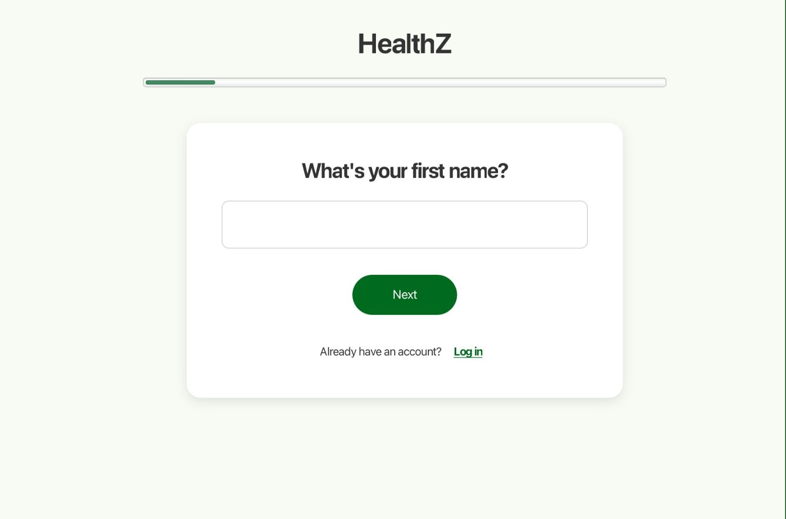
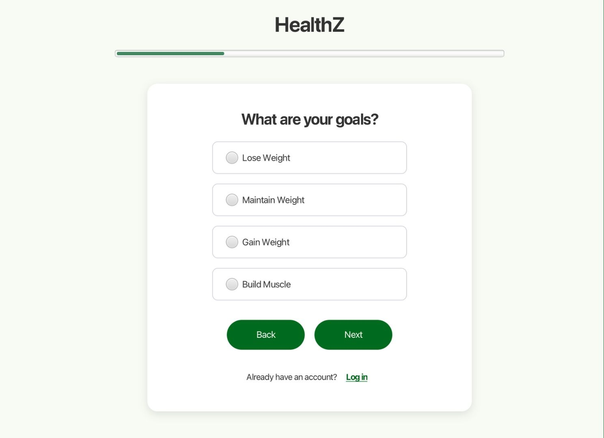
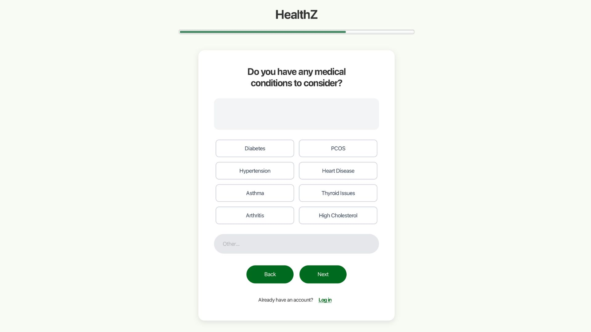
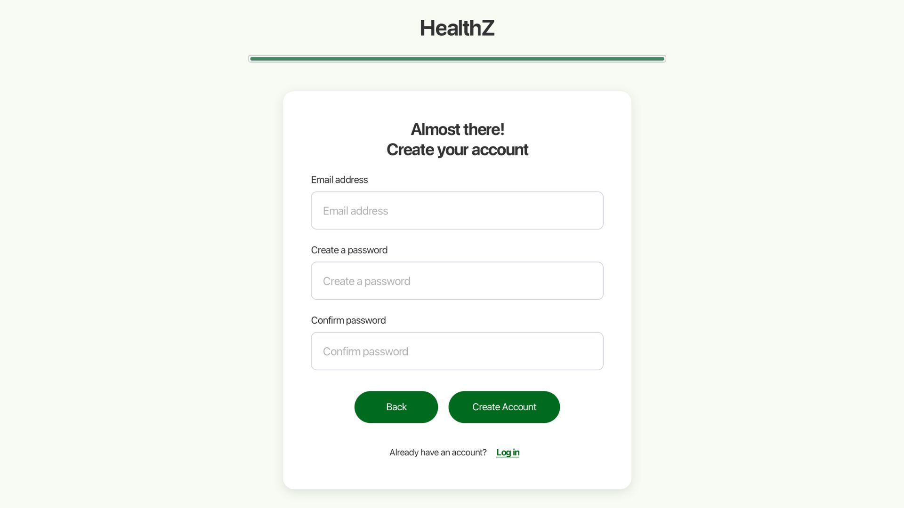
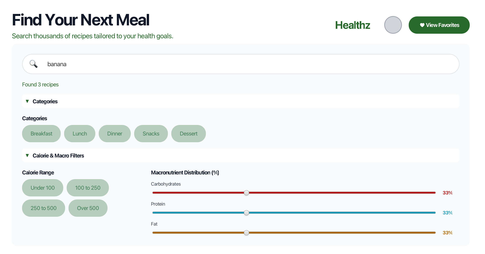
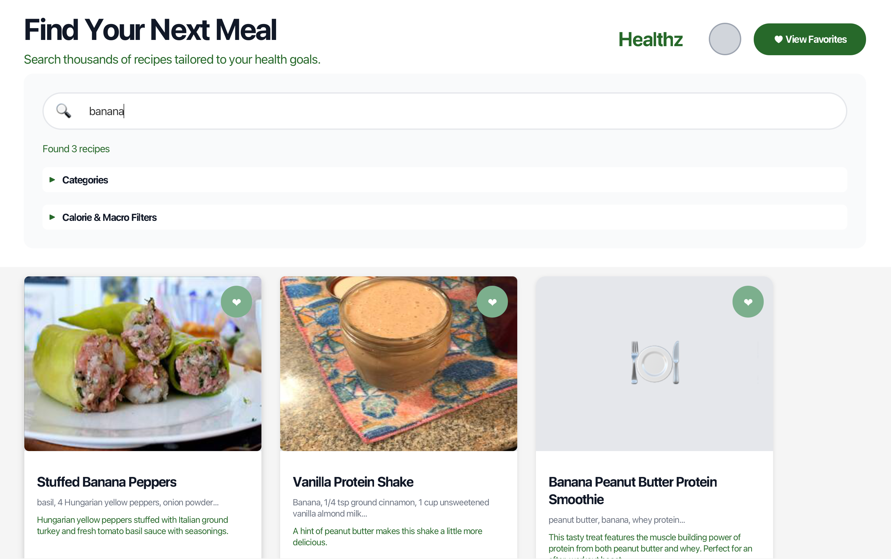
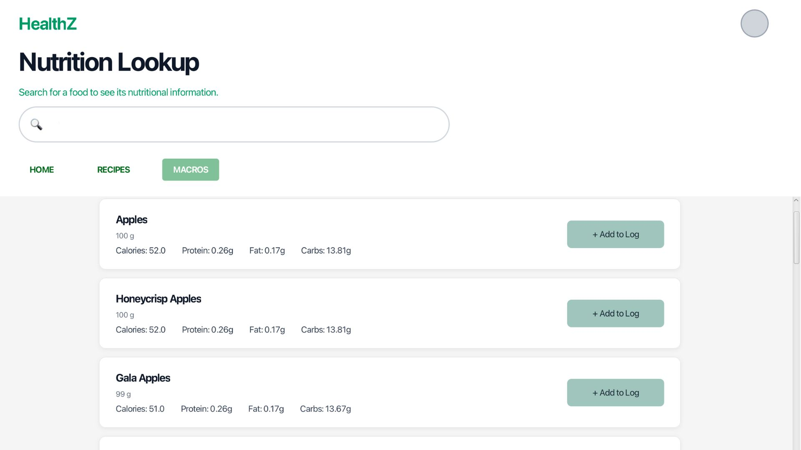
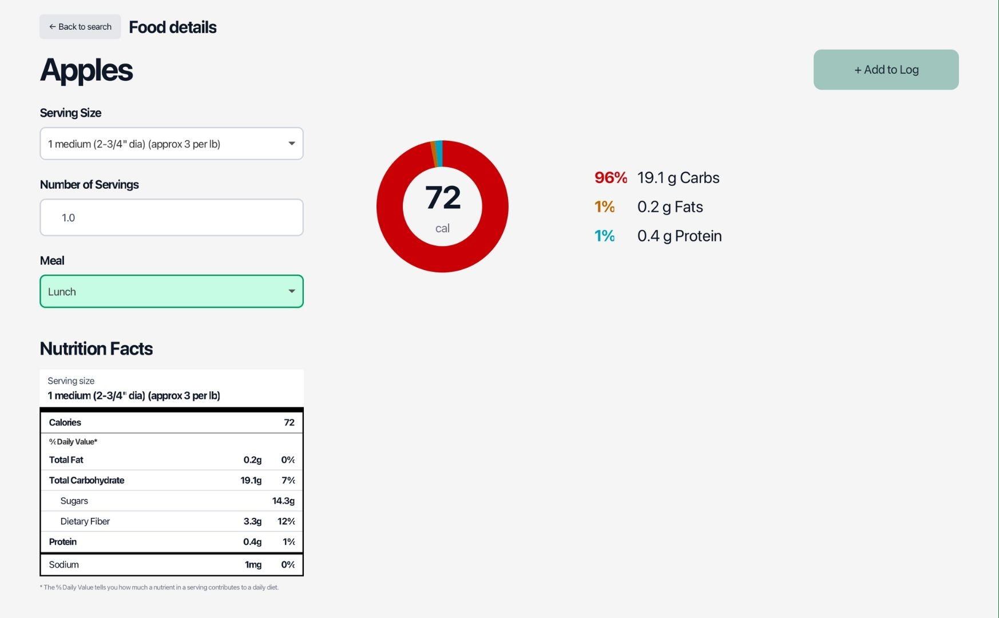
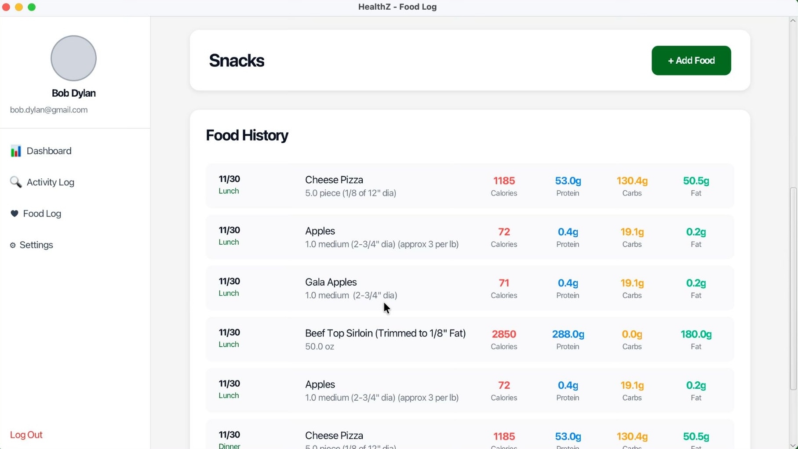
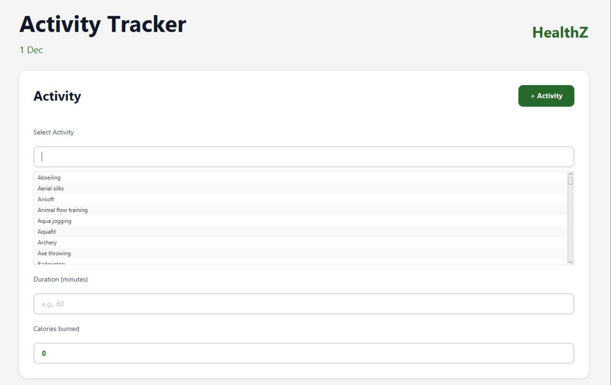

# HealthZ - Comprehensive Health & Nutrition Tracking Application

A comprehensive health and nutrition tracking application built with Clean Architecture principles, enabling users to discover recipes, track activities, and manage personalized health goals.

[Figma Design](https://www.figma.com/design/JOtTuUqmnF8bVy280Rmg1g/CSC207-HealthZ?node-id=0-1&t=rXSVEdYzSCTHGX1b-1)

## Home

---

## Onboarding / Sign Up Flow

---

## Search & Discovery

---

## Nutrition Information

---

## Tracking

---

## 🌟 Features

### 🍳 Recipe Search & Discovery
- Search 100,000+ recipes via FatSecret API
- Advanced filtering by macronutrient percentages (carbs, protein, fat)
- Real-time filtering with interactive sliders
- Detailed recipe views with ingredients, instructions, and nutrition facts

### ⭐ Favorite Recipes Management
- Save favorite recipes with one click
- Persistent storage using Supabase database
- Quick access to saved recipes across sessions
- Delete favorites with automatic UI refresh

### 🏃 Activity Tracking
- Log exercises from comprehensive exercise database
- Automatic calorie calculation based on user profile (weight, age, sex)
- Activity history with date tracking
- Integration with personalized dashboard

### 📊 Personalized Dashboard
- Daily calorie goal calculation using Mifflin-St Jeor equation
- Goal-adjusted recommendations (weight loss, maintenance, muscle gain)
- Activity history widget with recent exercises
- Real-time calorie tracking and progress visualization

### 👤 User Profile Management
- Secure authentication via Supabase Auth
- Customizable health profiles (height, weight, age, sex, activity level)
- Goal setting (weight loss, maintenance, muscle gain)
- Diet preferences and health conditions tracking
